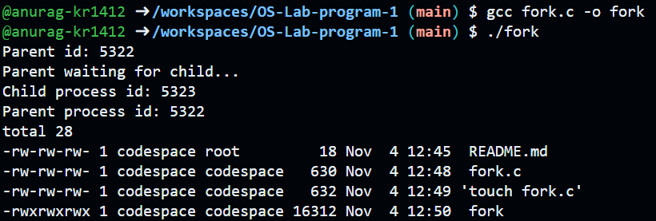

# Operating Systems Lab

## Experiment 1: Process Creation using fork() and exec()

### Program
The program creates a child process using fork()
and executes the Linux ls command using execl().

### Output

